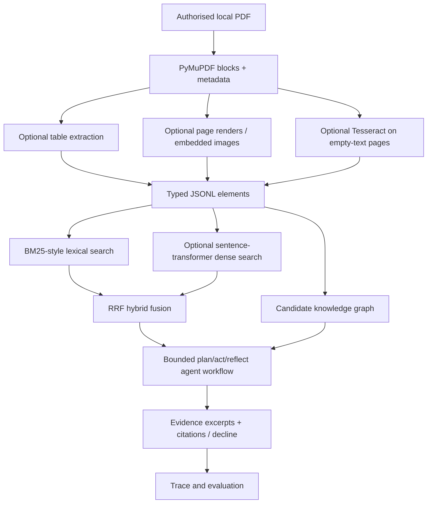

# Architecture

## Implemented pipeline

## Contracts
- **Element:** `element_id`, `doc_id`, `revision`, `section_number`, `section_title`, `page`, `bbox`, `element_type`, `text`, `extractor`; optional `table_json`, `markdown`, `image_path`, `sha256`, `needs_ocr`.
- **Chunk:** current implementation uses each typed element as an atomic retrieval unit. Parent-child section chunking is not yet implemented.
- **Graph node:** canonical `id`, `type`, optional aliases and source provenance.
- **Graph edge:** `source`, `relation`, `target`, `provenance` (`doc_id`, revision, section, page, element ID, bbox), `extraction_method`.
- **Citation:** `[doc_id, rev. revision, §section, p. page, element_id]`.
- **Gold row:** `id`, `question`, `gold_element_ids`, `category`; manually verified answer and verifier should be stored in the richer gold-set template.
- **Trace:** step number, action, inputs/outputs or result summary. The trace records planning, text retrieval, graph lookup, reflection/corrective retrieval decision and citation-verifier result.

## Design choices and limits
1. PyMuPDF is the dependency-light parser baseline. It is not a layout-parser comparison and does not reconstruct multi-page tables.
2. Table extraction is best-effort and depends on the installed PyMuPDF version. The extracted Markdown/JSON must be checked against the original page.
3. Tesseract is optional and only applied to pages with no selectable text when explicitly enabled. It is not Unlimited-OCR and does not satisfy the assignment's required benchmark.
4. Dense retrieval uses a local sentence-transformers model when installed and available. Hybrid mode reports a lexical fallback when the dependency is missing. The first model load may require downloading model weights.
5. RRF fuses lexical and dense ranked lists. An optional cross-encoder reranker and ColQwen2.5 adapter/MaxSim primitive are included, but neither model-backed path has been benchmarked on the real corpus.
6. Graph extraction uses patterns and mention-to-section anchors. Candidate edges require source verification; it is not a complete LLM extraction/entity-resolution pipeline.
7. Agent orchestration is a deterministic, bounded plain-Python workflow. It does not call an LLM, so it returns evidence excerpts rather than generated engineering synthesis.
8. The corpus and all demo fixtures are synthetic/not real USB spec evidence. No real-spec metric is claimed.
