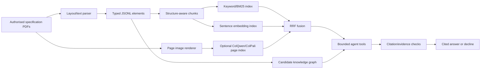
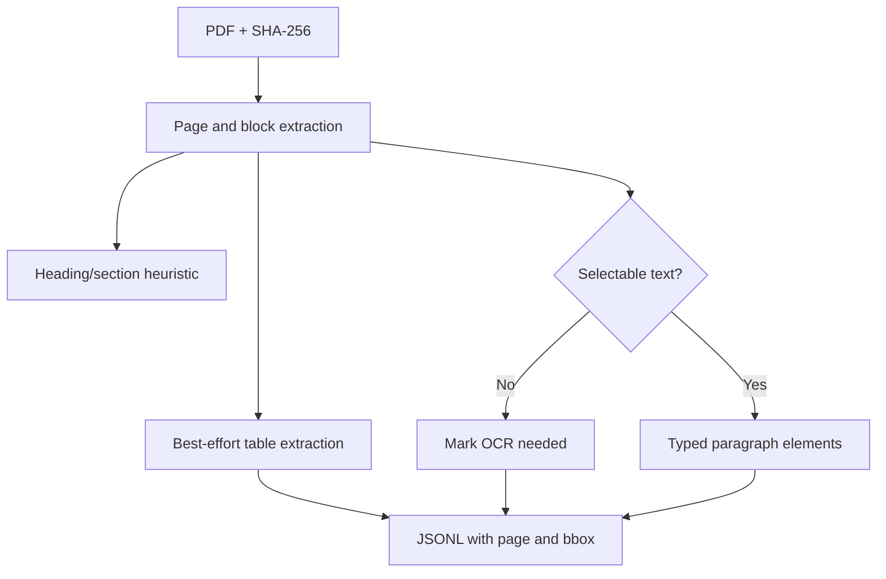
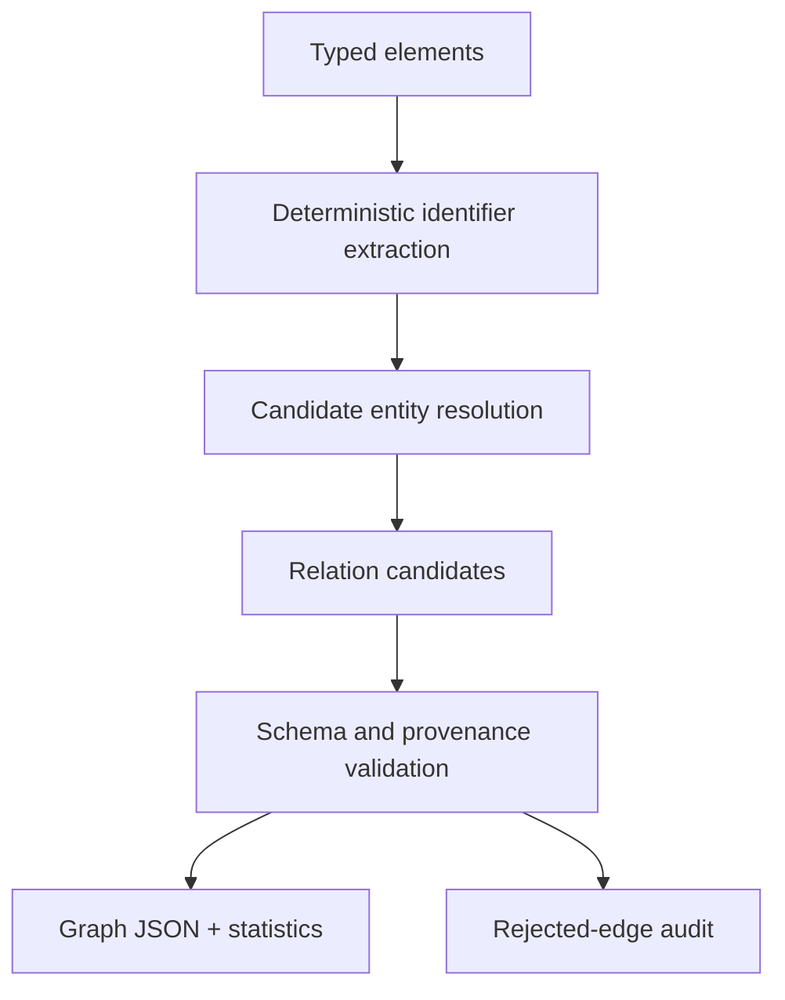
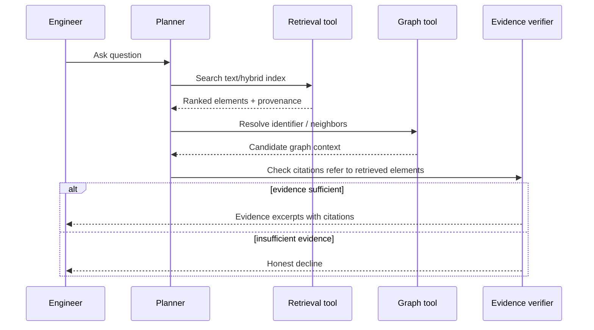
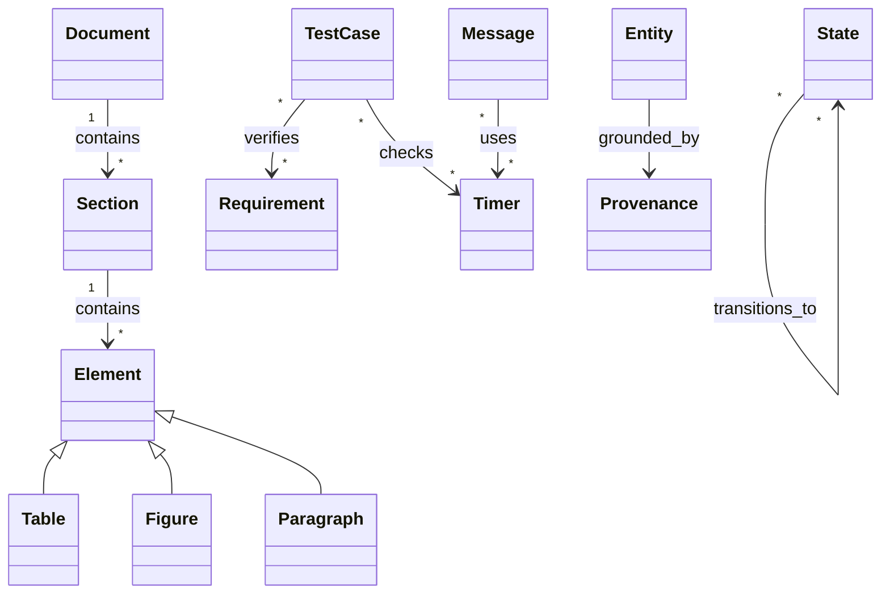

# Diagrams

## Architecture

## Ingestion data-flow

## Knowledge graph construction

## Agent sequence

## Ontology ER view

The graph and sequence diagrams describe the intended architecture; the current graph/agent stages are candidate extraction and deterministic workflow, not a complete LLM-based system.
